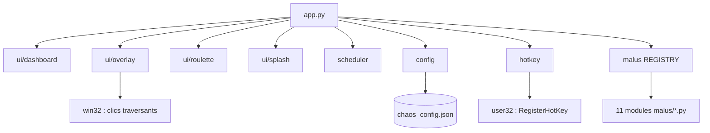

# Valorant Chaos Overlay


Un overlay pour streamers : des malus visuels aléatoires (flash blanc, vision en tunnel, faux écran bleu...) dessinés par-dessus l'écran.

## Ce que fait l'overlay / ce qu'il ne fait pas

**Ce qu'il fait**
- Il dessine des formes sur une fenêtre plein écran transparente, **transparente aux clics** (styles de fenêtre Win32) : la souris et le clavier passent au travers.
- La touche **HOME** rouvre le Dashboard. Elle utilise `RegisterHotKey`, le raccourci global standard de Windows : le **mode administrateur n'est plus nécessaire**. Si HOME est déjà prise par un autre programme, l'application l'indique au démarrage.
- Le bouton **QUITTER** du Dashboard ferme l'application et libère la touche HOME.

**Ce qu'il ne fait pas**
- Aucune lecture de la mémoire d'un processus, aucune injection, aucune macro, aucune capture d'écran, aucune interaction avec le jeu ou avec Vanguard.

Riot ne donne aucune garantie sur ce type d'outil : celui-ci ne fait que dessiner sur l'écran, mais son usage reste à vos risques.

## Les malus

Ordre du registre (celui du Dashboard). Durées par défaut, modifiables dans la configuration.

| Clé | Effet | Durée par défaut |
| :--- | :--- | :--- |
| `flashbang` | Écran blanc | 2,5 s |
| `tunnel_vision` | Tout est noir sauf un carré de 600 px au centre | 8 s |
| `hud_blocker` | Trois rectangles noirs sur des zones du HUD (haut gauche, bas droite, bas) | 12 s |
| `fake_crosshair` | Une grande croix verte décalée du centre | 10 s |
| `scanlines` | Une bande noire de 4 px toutes les 8 px sur tout l'écran | 10 s |
| `mlg_fullscreen` | Joue `mlg.gif` au centre de l'écran | 6 s |
| `fake_crash` | Faux écran bleu « VANGUARD ANTI-CHEAT CRITICAL ERROR » (un simple dessin : le programme ne communique pas avec Vanguard) | 2,5 s |
| `blind_spot` | Un disque noir de 160 px au centre | 8 s |
| `paranoia` | Quatre faux pings d'ennemi autour du centre | 4 s |
| `screen_crack` | 15 fissures grises qui partent d'un point tiré au hasard | 8 s |
| `mosquito` | Un carré noir de 15 px qui rebondit sur les bords de l'écran | 10 s |

## Configuration

Le fichier `chaos_config.json` est lu et écrit à côté de l'exe (ou à la racine du projet en version script). Il est enregistré quand vous cliquez sur « DÉMARRER LE CHAOS ». S'il est absent, les valeurs par défaut sont utilisées.

| Champ | Contenu | Défaut | Bornes |
| :--- | :--- | :--- | :--- |
| `frequency_s` | secondes entre deux malus | 60 | 1 à 3600 |
| `enabled` | `{clé: true/false}` par malus | tout activé | |
| `durations_ms` | `{clé: durée en ms}` par malus | durées du tableau | 500 à 60000 |
| `hotkey` | touche du Dashboard | `"home"` | seule `"home"` est prise en charge |

Un champ invalide reprend sa valeur par défaut (avertissement dans le journal) ; un fichier illisible ou un JSON invalide : tout revient aux valeurs par défaut. Les clés inconnues sont ignorées.

Le journal est écrit dans `chaos_overlay.log` à côté de l'exe (rotation à 256 Ko, 2 sauvegardes). Une erreur fatale écrit aussi `crash_log.txt`.

## Installation depuis les sources

Prérequis : Windows, Python 3.10 ou plus.

```bat
git clone https://github.com/MalikChopa/Valorant_Chaos_Overlay.git
cd Valorant_Chaos_Overlay
py -3.10 -m venv .venv
.venv\Scripts\activate
pip install -e .[dev]
```

| Action | Commande |
| :--- | :--- |
| Lancer l'application | `python -m chaos_overlay` |
| Tests | `pytest` |
| Vérification des types | `mypy` |
| Construire l'exe | `pyinstaller chaos_overlay.spec` (résultat : `dist\valorant_roulette.exe`, `mlg.gif` embarqué) |

Pour jouer avec l'overlay, réglez Valorant en **plein écran fenêtré** (borderless) : un overlay ne s'affiche pas au-dessus d'un plein écran exclusif (comportement général de Windows ; non vérifié avec cette version).

## Releases

Téléchargez `valorant_roulette.exe` dans la release **v2.0.0** (onglet Releases), puis lancez-le : pas besoin du mode administrateur. Les releases v1.0.0 et v1.1.0 viennent de l'ancienne version (un seul fichier).

## Architecture



### Ajouter un malus

1. Créer `chaos_overlay/malus/mon_malus.py` avec une classe qui hérite de `Malus`, décorée par `@register`.
2. Y définir `key` (identifiant unique), `default_duration_ms` et la méthode `_draw()`. Prendre un malus existant (par exemple `flashbang.py`) comme modèle.
3. Ajouter `from chaos_overlay.malus import mon_malus` dans `chaos_overlay/malus/__init__.py` : l'ordre des imports est l'ordre d'affichage dans le Dashboard.

## Crédits

- Made by Chupa.
- `mlg.gif` : trouvé sur un site de GIF, source inconnue, droits non vérifiés. Il n'est **pas couvert par la licence MIT**.

## Licence

MIT (voir `LICENSE`), à l'exception de `mlg.gif`.
