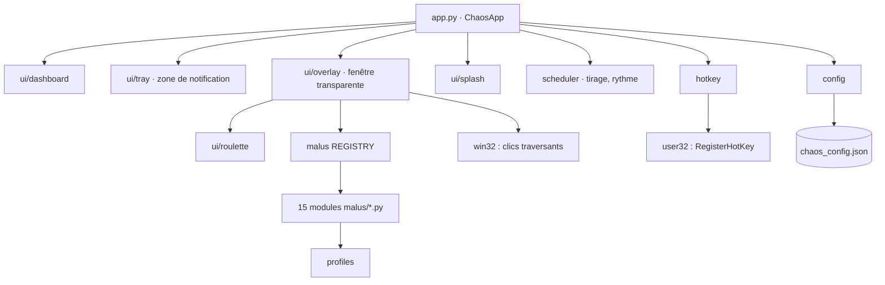

# Chaos Overlay

[](https://github.com/MalikChopa/Valorant_Chaos_Overlay/actions/workflows/ci.yml)

-41cd52?style=for-the-badge&logo=qt)


Un overlay pour streamers de FPS (Valorant, Counter-Strike 2, Apex Legends, Overwatch 2, et tous les autres) : à intervalle régulier, une roulette tire un **malus visuel** (flash, vision tunnel, lunette de sniper, faux kill feed…) dessiné par-dessus le jeu. Le défi : continuer à jouer.

Anciennement *Valorant Chaos Overlay* : la v3 s'ouvre à tous les FPS et passe à Qt.

## Ce que fait l'overlay, ce qu'il ne fait pas

**Ce qu'il fait**
- Il dessine sur une fenêtre transparente, plein écran, **transparente aux clics** : la souris et le clavier passent au travers, elle ne prend jamais le focus.
- Il se pilote depuis un **Dashboard**, une **icône dans la zone de notification** et la touche **HOME** (raccourci Windows standard `RegisterHotKey`, sans mode administrateur).

**Ce qu'il ne fait pas**
- Aucune lecture de la mémoire d'un processus, aucune injection, aucune macro, **aucune capture d'écran**, aucune détection du jeu, aucune interaction avec le jeu ni avec son anti-triche (Vanguard, VAC, Easy Anti-Cheat…).
- Le « profil de jeu » est choisi à la main : il ne sert qu'à placer les caches du malus *HUD masqué*.

Aucun éditeur ne garantit quoi que ce soit sur ce type d'outil : celui-ci ne fait que dessiner sur l'écran, mais son usage reste à vos risques.

## Prise en main

1. Lancez `chaos_overlay.exe` (ou `python -m chaos_overlay`). Un écran de démarrage, puis le Dashboard s'ouvrent.
2. Choisissez le **profil de jeu**, l'**écran** (si vous en avez plusieurs) et la **fréquence**.
3. Cochez les malus voulus, réglez leur durée, et essayez-les avec **▶** (affichage immédiat, sans roulette).
4. Cliquez sur **DÉMARRER LE CHAOS**. Le Dashboard se ferme ; le compte à rebours s'affiche dans l'infobulle de l'icône.
5. En jeu : **HOME** rouvre le Dashboard. Clic droit sur l'icône de notification : *Mettre en pause / Reprendre*, *Lancer un malus maintenant*, *Quitter*.

Réglez le jeu en **plein écran fenêtré** (borderless) : sous Windows, aucune fenêtre ne s'affiche au-dessus d'un jeu en plein écran exclusif.

## Les malus

Ordre du Dashboard. Les tailles sont pensées pour du 1080p et suivent la résolution (1440p, 4K…). Durées modifiables dans le Dashboard.

| Clé | Nom | Effet | Durée par défaut |
| :--- | :--- | :--- | :--- |
| `flashbang` | Flashbang | Écran blanc d'un coup, qui s'estompe | 2,5 s |
| `tunnel_vision` | Vision tunnel | Tout est noir sauf un carré au centre | 8 s |
| `hud_blocker` | HUD masqué | Caches noirs sur la minimap, la vie, les munitions (selon le profil) | 12 s |
| `fake_crosshair` | Faux viseur | Une grande croix verte décalée du centre | 10 s |
| `scanlines` | Scanlines | Bandes noires horizontales sur tout l'écran | 10 s |
| `mlg_fullscreen` | MLG | Joue `mlg.gif` au centre de l'écran | 6 s |
| `fake_crash` | Faux crash | Faux écran bleu « ANTI-CHEAT CRITICAL ERROR » (un simple dessin) | 2,5 s |
| `blind_spot` | Angle mort | Un disque noir au centre | 8 s |
| `paranoia` | Paranoïa | Quatre faux pings d'ennemi qui pulsent autour du viseur | 4 s |
| `screen_crack` | Écran fissuré | 15 fissures depuis un point au hasard | 8 s |
| `mosquito` | Moustique | Un petit carré noir qui vole partout | 10 s |
| `sniper_scope` | Lunette de sniper | **Nouveau.** Vue à travers une lunette qui tangue, le reste est noir | 8 s |
| `low_hp` | PV critiques | **Nouveau.** Bords de l'écran rouges qui battent comme un cœur | 8 s |
| `fake_kill_feed` | Faux kill feed | **Nouveau.** De fausses éliminations défilent en haut à droite… souvent contre « TOI » | 6 s |
| `drunk_crosshair` | Viseur ivre | **Nouveau.** Un faux viseur qui tangue autour du centre | 10 s |

Les malus apparaissent et disparaissent en fondu (sauf ceux qui doivent surprendre : flash, faux crash). Ils peuvent se superposer.

## Profils de jeu

| Profil | Zones masquées par *HUD masqué* |
| :--- | :--- |
| Générique (tous les FPS) | minimap en haut à gauche, coins bas gauche et bas droite |
| Valorant | minimap, bas droite, bas gauche-centre (zones de la v2) |
| Counter-Strike 2 | radar, vie et armure, munitions |
| Apex Legends | minimap, escouade et vie, armes |
| Overwatch 2 | objectif en haut, vie, capacités et munitions |

Les zones sont des approximations, en fractions de l'écran (`chaos_overlay/profiles.py`) : un profil s'ajoute en quelques lignes.

## Configuration

`chaos_config.json` est écrit à côté de l'exe (ou à la racine du projet en version script) quand vous cliquez sur « DÉMARRER LE CHAOS ». Un fichier de la v2 reste lisible.

| Champ | Contenu | Défaut | Bornes |
| :--- | :--- | :--- | :--- |
| `frequency_s` | secondes entre deux malus | 60 | 1 à 3600 |
| `enabled` | `{clé: true/false}` par malus | tout activé | |
| `durations_ms` | `{clé: durée en ms}` par malus | durées du tableau | 500 à 60000 |
| `profile` | profil de jeu | `"generic"` | `generic`, `valorant`, `cs2`, `apex`, `overwatch2` |
| `screen` | numéro de l'écran (0 = le premier) | 0 | 0 à 15 ; écran absent : l'écran principal |
| `hotkey` | touche du Dashboard | `"home"` | seule `"home"` est prise en charge |

Un champ invalide reprend sa valeur par défaut (avertissement dans le journal) ; un fichier illisible ou un JSON invalide : tout revient aux valeurs par défaut. Les clés inconnues sont ignorées.

Journal : `chaos_overlay.log` à côté de l'exe (rotation à 256 Ko, 2 sauvegardes). Une erreur fatale écrit aussi `crash_log.txt`.

## Installation depuis les sources

Prérequis : Windows 10/11, Python 3.10 ou plus.

```bat
git clone https://github.com/MalikChopa/Valorant_Chaos_Overlay.git
cd Valorant_Chaos_Overlay
py -3 -m venv .venv
.venv\Scripts\activate
pip install -e .[dev]
```

| Action | Commande |
| :--- | :--- |
| Lancer l'application | `python -m chaos_overlay` |
| Tests | `pytest` |
| Vérification des types | `mypy` |
| Construire l'exe | `pyinstaller chaos_overlay.spec` (résultat : `dist\chaos_overlay.exe`, `mlg.gif` et l'icône embarqués) |
| Régénérer l'icône de l'exe | `python scripts/make_icon.py` |

Les tests tournent sans écran (plateforme Qt `offscreen`) : chaque malus est dessiné dans une image, à des instants choisis, et vérifié pixel par pixel. Ils passent aussi sous macOS et Linux ; seul le raccourci HOME réel est propre à Windows.

La CI GitHub Actions (`.github/workflows/ci.yml`) lance mypy et les tests sous Windows (Python 3.10 et 3.13), puis construit l'exe, téléchargeable dans les artefacts du run.

## Architecture



Un malus est un objet qui sait **se dessiner à un instant donné** (`render(painter, elapsed_ms)`) : pas de fenêtre ni de minuteur à lui. L'overlay les redessine à ~30 images/s **seulement quand quelque chose est affiché** ; au repos, il ne consomme rien. Détails : [`docs/ARCHITECTURE.md`](docs/ARCHITECTURE.md).

### Ajouter un malus

1. Créer `chaos_overlay/malus/mon_malus.py` avec une classe qui hérite de `Malus`, décorée par `@register`.
2. Y définir `key`, `label`, `description`, `default_duration_ms` et `paint(painter, elapsed_ms)`. Les tirages au hasard se font dans `setup()`. Prendre `flashbang.py` (statique) ou `drunk_crosshair.py` (animé) comme modèle.
3. Ajouter `from chaos_overlay.malus import mon_malus` dans `chaos_overlay/malus/__init__.py` : l'ordre des imports est l'ordre du Dashboard.

Les tests communs (dessine quelque chose, rien après sa durée, même graine = même image, toutes résolutions) s'appliquent automatiquement au nouveau malus.

## Releases

La v3 n'est pas encore publiée. La release **v2.0.0** (`valorant_roulette.exe`, Tkinter, Valorant seulement) reste disponible dans l'onglet Releases.

## Crédits

- Made by Chopa.
- `mlg.gif` : trouvé sur un site de GIF, source inconnue, droits non vérifiés. Il n'est **pas couvert par la licence MIT**.

## Licence

MIT (voir `LICENSE`), à l'exception de `mlg.gif`.

---

Créé par **Malik Moussaoui** (Chopa), développeur à Toulouse · [tous mes projets](https://malikchopa.github.io/) · [GitHub](https://github.com/MalikChopa)
